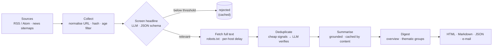

# Company News Radar

[](https://github.com/claudio-ai-lab/company-news-radar/actions/workflows/ci.yml)


**A configurable LLM pipeline that turns public news feeds into a short, company-specific daily briefing.**

You describe your company once in YAML: what it does, who reads the briefing, which topics
matter, how to score relevance, which suppliers, customers and competitors to watch, and
which feeds to read. The pipeline screens every headline against that profile, fetches
the articles that pass, merges duplicate coverage, writes grounded summaries in the
language you choose and produces one digest a day (HTML, Markdown, JSON, optionally
e-mail).

The code is generic. Everything that describes a particular organisation lives in a
config file that you keep private; this repository ships only two fictional example
profiles.

---

## Why

Keyword alerts are cheap but noisy: "strike" matches bowling, "tariff" matches phone
plans, "bankruptcy" matches football clubs. Reading dozens of feeds by hand is slow. What
a team actually needs is a judgement against *its own* situation: does this story change
our supply, our costs, our customers or our rules? This project puts an LLM where that
judgement is needed and keeps it on rails everywhere else.

## Pipeline



Every stage reads its input from the store and writes its result back, so an interrupted
run simply continues next time. A broken feed, an unreachable page or one invalid model
answer never stops the run.

## How the LLM is used, and kept on rails

| Stage | Model sees | Model returns | Guard rails |
|---|---|---|---|
| Screen | title, teaser, URL, source language | `topic`, `relevance` 1-10, `confidence`, `reason` | runs **before** any page is fetched (cheap); topic must be a configured id; gate = topic fit **and** score ≥ threshold; failures fail closed and are retried next run |
| Deduplicate | two titles + opening lines | `same_story`, `confidence` | only pairs flagged by cheap signals reach the model (URL slug, title overlap, shared entities, SimHash, optional multilingual embeddings); per-run pair cap; union-find clustering; an already published article stays canonical |
| Summarise | article text (any language) | `title`, `summary`, `key_points`, `impact`, `entities` | grounding rules first in the prompt; code removes key points that repeat the summary, caps lengths and counts, strips Markdown from titles |
| Digest | the day's summaries | executive summary + groups by article number | code validates the grouping: unknown or repeated numbers are dropped, forgotten articles go to a catch-all group, surplus groups are merged; on failure the digest is grouped by topic instead |

Shared mechanics in [`llm/base.py`](src/newsradar/llm/base.py):

- **Structured output.** Every response schema is a Pydantic model. Its JSON schema is
  sent with the prompt, the answer is parsed and validated, and an invalid answer gets
  exactly one repair round that includes the validation error.
- **Retries.** Rate limits, timeouts and 5xx errors are retried with exponential backoff.
- **Cost control.** Every call, including failed ones, is recorded with tokens and price
  (prices come from the config). A daily budget is checked before each call; when it is
  reached, remaining LLM work is deferred to the next run and the digest is built from
  what is ready. `newsradar costs` prints the ledger.
- **Caching.** Screening results are cached by (prompt, model, title, URL), summaries by
  (prompt, model, title, text). A prompt or profile change invalidates the cache
  automatically. The relevance threshold is applied *after* the cache, so tuning it costs
  nothing.
- **Safe rendering.** Feed and model text is untrusted. HTML is escaped first; only
  `**bold**` and `*italic*` are turned into tags afterwards.
- **Providers.** OpenAI, DeepSeek, Ollama or any OpenAI-compatible endpoint, and Google
  Gemini (optional extra). Each stage can use a different provider and model.

## Evaluation

[`evals/relevance/example-ag.jsonl`](evals/relevance/example-ag.jsonl) holds 40 invented
headlines for the fictional Example AG profile: 20 relevant, 20 not. Several irrelevant
items contain topic keywords ("bowling strike", "mobile tariffs", "football club
bankruptcy"), and several relevant ones contain hardly any. `newsradar eval` runs the real
screening stage (same prompt, schema and gate, no cache) and reports precision, recall,
F1, topic accuracy, a threshold sweep and every miss.

Results from 18 October 2026, relevance threshold 6:

| Classifier | Precision | Recall | F1 | Topic accuracy | Cost |
|---|---:|---:|---:|---:|---:|
| Keyword baseline (offline heuristic, same profile) | 0.88 | 0.70 | 0.78 | 0.93 | $0 |
| `gpt-4o-mini` | 1.00 | 0.95 | 0.97 | 1.00 | $0.0093 for 40 headlines |

Full reports: [`evals/relevance/results/`](evals/relevance/results/).

What the numbers do and do not say:

- The set is small, synthetic and was written together with the profile. It measures
  whether a model applies *this* profile, not general news judgement.
- The first prompt version scored a recall of 0.80: the model put indirect signals
  (central-bank decisions, robot orders) at 2/10 instead of the middle of the rubric.
  Asking for topic fit and importance as two separate questions fixed that. The prompt
  deliberately contains no examples from the evaluation set.
- The remaining miss is an ECB rate cut scored 5, which is where the rubric itself puts
  central-bank decisions. Whether that belongs in the briefing is a threshold choice; the
  sweep in the report shows the trade-off.

CI runs the evaluation with the offline baseline on every push (no API key needed).

## Quickstart

Requires Python 3.11+.

```bash
git clone https://github.com/claudio-ai-lab/company-news-radar.git
cd company-news-radar
python -m venv .venv && source .venv/bin/activate   # Windows: .venv\Scripts\activate
pip install -e ".[dev]"

# 1. Offline demo: local fixture feeds, deterministic stand-in for the LLM, no API key
newsradar run -c examples/example-ag/offline.yaml
# then open out/example-ag-offline/digest-<date>.html in a browser

# 2. The same profile on real public feeds with a real model
cp .env.example .env                                 # add OPENAI_API_KEY
newsradar check -c examples/example-ag/config.yaml --show-prompts
newsradar run -c examples/example-ag/config.yaml --limit 40

# 3. German briefing from German and English sources
newsradar run -c examples/stadtwerke-musterstadt/config.yaml

# Measure the relevance gate, inspect spending
newsradar eval -c examples/example-ag/config.yaml -d evals/relevance/example-ag.jsonl
newsradar costs -c examples/example-ag/config.yaml
```

In a test run on 18 October 2026 the Example AG profile collected 54 items from six public
feeds, screened 40, fetched and summarised 3 and produced a digest for **$0.011** with
`gpt-4o-mini`. Useful flags for `run`: `--offline`, `--limit N`, `--no-scrape`,
`--skip-collect`, `--redo-digest`, `--no-email`.

## Make it yours

```bash
cp examples/example-ag/config.yaml config/acme.yaml   # config/ is git-ignored
newsradar check -c config/acme.yaml --show-prompts
```

The main sections of a profile:

```yaml
profile:          # company, description, audience, focus, regions, watchlist
topics:           # id, label, description, keywords (hints), icon
relevance:        # threshold, rubric (score bands with meanings), guidance (extra rules)
impact:           # whose perspective "risk" / "opportunity" refers to, labels
sources:          # rss | sitemap, url or local path, language, priority, max_age_hours
llm:              # provider/model per stage, pricing, daily_budget_usd
pipeline:         # scraping, dedup thresholds, summary and digest limits
storage:          # sqlite:///data/acme.db
output:           # language, locale, timezone, formats, optional SMTP e-mail
prompts:          # dir: optional private prompt templates
```

- **Secrets** stay in the environment. The config only names variables
  (`api_key_env`, `smtp_password_env`); `${VAR}` and `${VAR:-default}` are expanded.
- **`extends: base.yaml`** lets a profile override only what differs from a base file.
- **Prompts** are Jinja2 templates under [`src/newsradar/prompts/<lang>/`](src/newsradar/prompts).
  To change wording without forking, put files with the same names in your `prompts.dir`.
- **Storage** sits behind a small [`Repository`](src/newsradar/storage/base.py) protocol;
  SQLite is the default and another backend only has to implement that interface.

### Languages

Source language and briefing language are configured separately:

- each source declares the language it is written in (`sources[].language`);
- `output.language` selects the prompt set (built in: `en`, `de`; any other language uses
  the English templates and the model is told to write in it) and the texts of the digest;
- `output.locale` (for example `en_GB`, `de_CH`) controls date and number formats via
  Babel, `output.timezone` the displayed times.

[`examples/stadtwerke-musterstadt`](examples/stadtwerke-musterstadt) is a German profile
for a fictional municipal utility that reads German and English feeds.

## Scheduling

One run per day is enough; runs are idempotent.

```cron
# cron (Linux/macOS): every weekday at 06:30
30 6 * * 1-5  cd /opt/company-news-radar && .venv/bin/newsradar run -c config/acme.yaml >> logs/radar.log 2>&1
```

```powershell
# Windows Task Scheduler
schtasks /Create /TN "News Radar" /SC WEEKLY /D MON,TUE,WED,THU,FRI /ST 06:30 `
  /TR "C:\radar\.venv\Scripts\newsradar.exe run -c C:\radar\config\acme.yaml"
```

## Project layout

```
src/newsradar/
├── config.py          # profile + settings (Pydantic), extends, ${ENV} expansion
├── sources/           # RSS/Atom and news-sitemap collectors
├── scraping.py        # robots.txt, per-host delay, trafilatura extraction
├── llm/               # provider clients, structured-output guard rails, costs, offline client
├── prompts/{en,de}/   # prompt templates per language
├── stages/            # classify, dedup, summarize, digest
├── storage/           # Repository protocol + SQLite
├── render/            # HTML / Markdown / JSON digest
├── i18n.py            # UI strings, default rubric, locale formatting
├── evaluation.py      # relevance evaluation
└── cli.py             # newsradar run | check | eval | costs
examples/              # two fictional profiles with offline fixtures
evals/relevance/       # labelled set and stored results
tests/                 # pytest suite; every LLM call is mocked
```

## Limits

- Screening sees only the headline and teaser. Stories with vague headlines can be missed.
- The model can still misjudge relevance (one live example: a regulator's decision on
  postal prices was rated as an energy story until a one-line `guidance` rule fixed it).
  Use `guidance`, the rubric and `newsradar eval` to tune your profile.
- Summaries are machine-generated. Prompts and post-processing reduce errors; they do not
  remove the need to open the source for decisions.
- Paywalled or script-heavy pages are not fetched; the article is then summarised from the
  feed text and marked as such. Pages disallowed by robots.txt are never fetched.
- The daily budget is a soft limit: calls already in flight still finish.
- The OpenAI client is exercised in live runs; the Gemini and DeepSeek paths are
  implemented against their documented APIs but are not covered by CI.
- SQLite suits one scheduled process; for concurrent writers, implement the repository
  protocol for another database.

## Origin

Company News Radar grew out of a news-monitoring pipeline I built entirely in my spare
time and brought into production use. This repository is an independent,
company-neutral re-implementation of its core ideas. It contains no configuration,
prompts, source lists or data from that deployment.

## License

[MIT](LICENSE)
